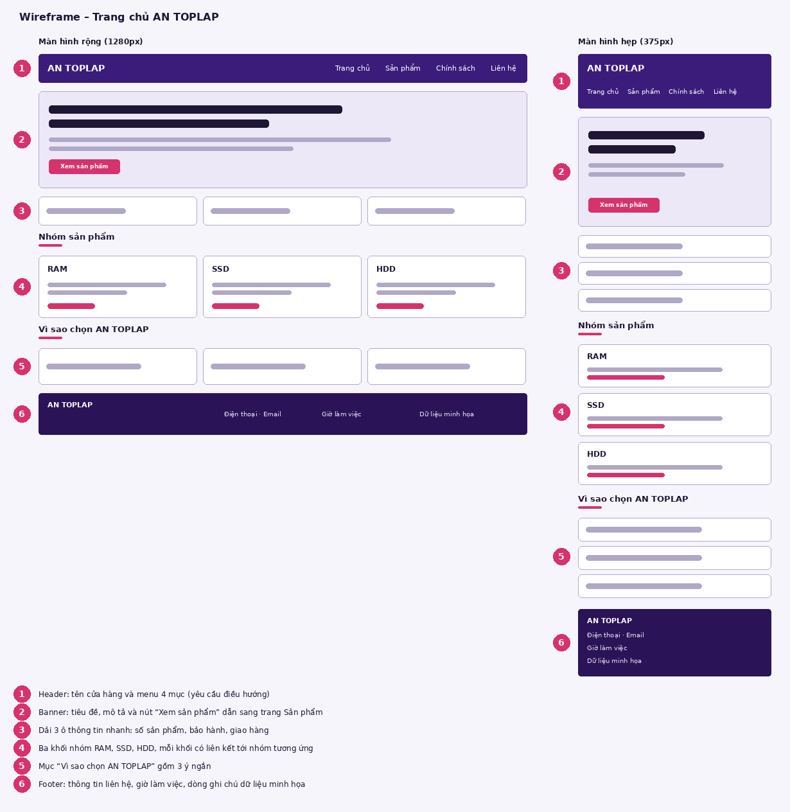
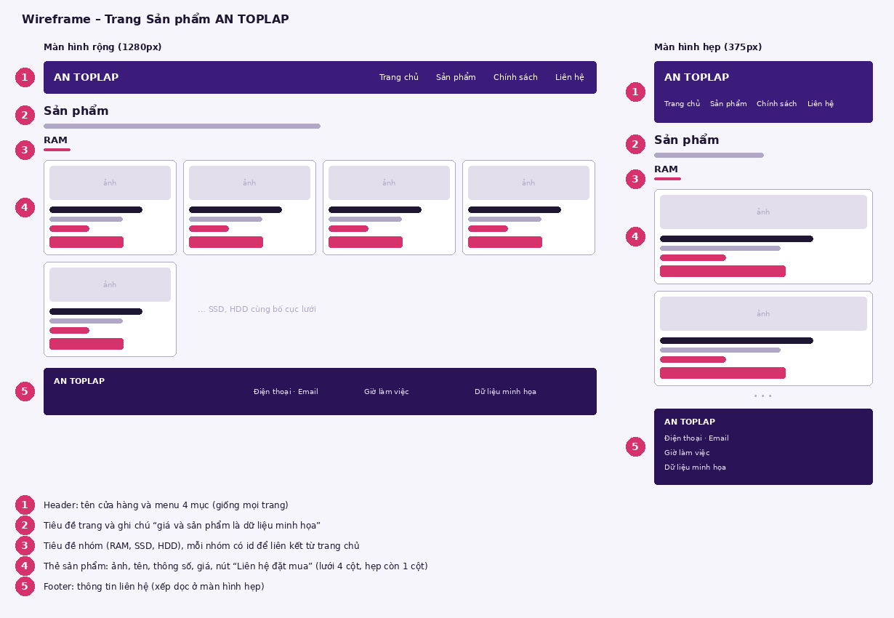

# Thiết kế – Website AN TOPLAP

## Cấu trúc trang
- Trang chủ (index.html): banner giới thiệu, 3 khối nhóm sản phẩm, lý do chọn AN TOPLAP.
- Sản phẩm (san-pham.html): 3 nhóm RAM / SSD / HDD, mỗi sản phẩm một thẻ.
- Chính sách (chinh-sach.html): bảo hành, đổi trả, giao hàng.
- Liên hệ (lien-he.html): số điện thoại, email, giờ làm việc, form minh họa.

## Ảnh minh chứng wireframe

### Trang chủ



### Sản phẩm



## Wireframe màn hình rộng
```
+--------------------------------------------------+
| AN TOPLAP   Trang chủ | Sản phẩm | Chính sách | Liên hệ |
+--------------------------------------------------+
| BANNER: Nâng cấp RAM, SSD cho máy của bạn        |
+--------------------------------------------------+
| [RAM]            [SSD]            [HDD]          |
+--------------------------------------------------+
| Thẻ | Thẻ | Thẻ | Thẻ     (lưới 4 cột)         |
+--------------------------------------------------+
| Footer: liên hệ – giờ làm việc                   |
+--------------------------------------------------+
```

## Wireframe màn hình hẹp
```
+------------------+
| AN TOPLAP  [Menu]|
| Banner           |
| [RAM]            |
| [SSD]            |
| [HDD]            |
| Thẻ | Thẻ        |
| Footer           |
+------------------+
```

## Lý do chọn cách bố trí
- Menu ngang đặt trên cùng vì cửa hàng chỉ có 4 trang, người xem tìm nhanh.
- Lưới thẻ sản phẩm giúp so sánh nhiều sản phẩm cùng lúc; thông số nằm ngay
  dưới tên, giá nằm cạnh nút liên hệ để người xem hành động ngay.
- Ba khối nhóm ở trang chủ dẫn thẳng tới phần tương ứng, ít thao tác hơn.
- Ở màn hình hẹp, lưới giảm cột để chữ và ảnh không bị bóp nhỏ; menu gọn lại
  để nhường chỗ cho nội dung.
- Màu phong cách trẻ trung ,năg động phù hợp với sinh viên

## Màu sắc và chữ
- Dùng font hệ thống (sans-serif) để không phụ thuộc thư viện ngoài.
- Màu tím cho header, màu hồng nhấn cho nút và giá; nền sáng, chữ tối để dễ đọc.
- Màu chủ đạo: tím #3B1C7A cho header, chữ trắng #FFFFFF; footer
  #2A1457, chữ #E9E3F7; nút #D6336C, chữ #FFFFFF; giá #C2255C;
  nền #F7F5FC, chữ #1E1633; gạch chân menu khi hover #FFB3CF.
